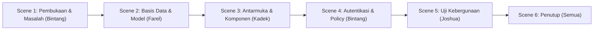

# NASKAH VIDEO PRESENTASI PROYEK CIBO (*CINEMA BOOKING SYSTEM*)

**Mata Kuliah:** Web Framework (INF625313) — Semester 5  
**Dosen Pengampu:** Mahendra Pratama, S.T., M.Eng.  
**Tech Stack:** Laravel 13 · React 19 · Inertia 3 · PostgreSQL · Tailwind CSS  
**Durasi Total:** ± 8 – 10 Menit  

---

## DAFTAR PEMERAN & PEMBAGIAN PERAN

| Nama Anggota | Area Kerja | Fokus Presentasi & Demonstrasi Kode |
| :--- | :--- | :--- |
| **Bintang Prastyo Kusumo Wicaksono** | **Autentikasi & Otorisasi** (Ketua Tim) | Pembukaan, pengamanan rute, middleware `PastikanPeran`, Policy `FilmPolicy`, pengujian HTTP 403, dan props `can`. |
| **Farel Raditya Surya Negara** | **Basis Data & Model** | Perancangan ERD 3 modul PostgreSQL, migrasi presisi (`decimal`, foreign key), model Eloquent (`$fillable`, relasi), seeder/factory. |
| **Kadek Dwi Octo Lesa Candigo** | **Antarmuka & Komponen** | Komponen React 19 & Tailwind CSS, hierarki komponen (`Kartu`, `BarisFilm`, `Kosong`), state denah kursi & konfirmasi hapus, 4 umpan balik UI. |
| **Joshua Andrew Siahaan** | **Uji Kebergunaan & Dokumentasi** | Skenario Usability Testing Minggu 13 dengan 5 calon pengguna, metrik evaluasi kebergunaan, dan panduan replikasi instalasi sistem. |

---

## SUSUNAN ACARA & SCENE-BY-SCENE

---

### SCENE 1: PEMBUKAAN & LATAR BELAKANG PROYEK (00:00 - 01:30)
**Pembicara:** Bintang Prastyo Kusumo Wicaksono  
**Tampilan Layar (Visual):**
- *Cut-in* kamera menampilkan seluruh anggota tim / opening bumper slide judul: **"CIBO - Cinema Booking System"**.
- Perekaman layar (*screen recording*) menampilkan antarmuka utama aplikasi CIBO berjalan mulus di peramban (`http://localhost:8000`).

**Naskah Dialog:**
> **Bintang:**  
> "Halo semuanya! Selamat datang di presentasi tugas proyek mata kuliah Web Framework (INF625313) kelas kami. Saya **Bintang Prastyo Kusumo Wicaksono** selaku ketua tim, bersama rekan-rekan saya: **Farel Raditya Surya Negara**, **Kadek Dwi Octo Lesa Candigo**, dan **Joshua Andrew Siahaan**."  
>  
> "Aplikasi yang kami bangun bernama **CIBO (*Cinema Booking System*)**. Proyek ini lahir untuk menjawab permasalahan nyata pada operasional loket bioskop konvensional: antrean fisik yang padat menjelang jam tayang film favorit, staf loket yang kesulitan memvisualisasikan ketersediaan kursi secara *real-time* sehingga rawan terjadi pemilihan kursi ganda (*double booking*), serta ketiadaan laporan rekapitulasi okupansi yang otomatis dan terpercaya bagi pengelola."  
>  
> "Sesuai kontrak perkuliahan dan batasan yang telah digariskan, CIBO dibangun sebagai *monolit modern* menggunakan **Laravel 13, React 19, Inertia 3, Tailwind CSS, dan basis data PostgreSQL sungguhan**. Sekarang, mari kita bedah fondasi arsitektur data sistem ini yang akan dipaparkan oleh rekan saya, Farel."

---

### SCENE 2: PERANCANGAN BASIS DATA & MODEL ELOQUENT (01:30 - 03:30)
**Pembicara:** Farel Raditya Surya Negara  
**Tampilan Layar (Visual):**
- Diagram ERD 3 modul saling berelasi (`films`, `jadwals`, `pemesanans`).
- Tampilan teks editor (VS Code) membuka berkas migrasi: `create_films_table.php`, `create_jadwals_table.php`, dan `create_pemesanans_table.php`.
- Tampilan terminal menjalankan perintah: `php artisan migrate:fresh --seed`.
- Tampilan model Eloquent: `app/Models/Film.php` dan `app/Models/Jadwal.php`.

**Naskah Dialog:**
> **Farel:**  
> "Terima kasih, Bintang. Saya **Farel Raditya Surya Negara**, penanggung jawab area Basis Data & Model."  
>  
> "Di CIBO, seluruh skema data dirancang sebagai kode (*schema as code*) menggunakan berkas migrasi Laravel pada basis data **PostgreSQL**. Kami mengimplementasikan 3 entitas modul data yang saling berelasi erat:
> 1. Modul **Film (`films`)** sebagai katalog induk film.
> 2. Modul **Jadwal Tayang (`jadwals`)** yang memiliki relasi *foreign key* `film_id` ke tabel film dengan *constraint* `cascadeOnDelete()`.
> 3. Modul **Pemesanan Tiket (`pemesanans`)** yang mencatat transaksi loket dan mengikat `jadwal_id` serta `user_id`."  
>  
> *(Pindah sorotan layar ke potongan baris kode migrasi)*  
> "Sesuai kaidah ketat PostgreSQL yang diajarkan pada Pertemuan 3:
> - Untuk kolom mata uang seperti `harga_tiket` dan `total_bayar`, kami menggunakan tipe **`decimal(12, 2)`** dan secara tegas menolak pemakaian `float` demi mencegah kekeliruan pembulatan pecahan.
> - Kami menghindari penggunaan tipe database `enum` bawaan PostgreSQL yang kaku, melainkan menggunakan string dengan validasi terpusat di aplikasi.
> - Pencarian judul film pada query kami menggunakan operator khusus PostgreSQL yaitu **`ILIKE`**, sehingga pencarian bersifat *case-insensitive* tanpa membeda-bedakan huruf besar dan kecil."  
>  
> *(Pindah sorotan layar ke kode Model Eloquent)*  
> "Pada sisi Model Eloquent, kami mendaftarkan `$table` secara eksplisit dan mendefinisikan `$fillable` secara ketat untuk menangkal celah keamanan *mass assignment vulnerability*, mematuhi larangan dosen untuk tidak menggunakan `$guarded = []`. Kami juga telah mengkonfigurasi relasi `hasMany` dan `belongsTo` secara tepat serta menerapkan *Eager Loading* `with()` pada setiap kueri controller untuk mencegah malapetaka performa **N+1 Query Problem**."  
>  
> "Kesiapan skema ini kami buktikan dengan uji *laptop kosong*: cukup menjalankan `php artisan migrate:fresh --seed`, seluruh tabel dan data contoh realistis langsung terisi sempurna. Selanjutnya, implementasi antarmuka pengguna akan didemonstrasikan oleh Kadek."

---

### SCENE 3: ARSITEKTUR KOMPONEN REACT & FORMULIR INERTIA (03:30 - 06:00)
**Pembicara:** Kadek Dwi Octo Lesa Candigo  
**Tampilan Layar (Visual):**
- Perekaman layar navigasi katalog film di peramban, mengklik tombol *Rincian* (membuktikan transisi instan SPA tanpa *full reload* peramban).
- Sorotan struktur folder `resources/js/components/` dan `resources/js/pages/film/`.
- Tampilan kode `Kartu.jsx`, `BarisFilm.jsx`, `Kosong.jsx`, dan `PesanFlash.jsx`.
- Demonstrasi interaksi form tambah film: sengaja mengosongkan input & menekan submit &rarr; muncul pesan galat validasi merah dan nilai input tidak hilang.
- Demonstrasi tombol submit berubah menjadi *'Menyimpan…'* dan *disabled* saat diklik.
- Demonstrasi tombol konfirmasi hapus berbasis state lokal `useState` (*"Yakin? Ya / Batal"*).

**Naskah Dialog:**
> **Kadek:**  
> "Terima kasih, Farel. Saya **Kadek Dwi Octo Lesa Candigo**, penanggung jawab Antarmuka & Komponen."  
>  
> "Di CIBO, kami telah menyelesaikan tagihan P2 di mana seluruh modul tampilan telah 100% beralih dari Blade ke **React 19** menggunakan **Inertia 3** dan utilitas gaya **Tailwind CSS**. Seperti yang teman-teman lihat di layar, navigasi antara katalog dan rincian film berjalan sangat mulus seperti aplikasi *Single Page Application*, karena perpindahan halamannya menggunakan komponen `<Link>` dari `@inertiajs/react` tanpa memuat ulang seluruh aset berkas CSS dan JavaScript."  
>  
> *(Pindah sorotan layar ke kode VS Code)*  
> "Dalam merancang antarmuka, kami menerapkan prinsip *Single Responsibility*:
> 1. Komponen **`Kartu.jsx`** bertindak sebagai wadah universal yang fleksibel menggunakan properti `children`.
> 2. Komponen **`BarisFilm.jsx`** mengisolasi tampilan kartu item film dan selalu diberikan pengenal unik yang stabil yaitu `key={film.id}`, bukan indeks urut array, demi menghindari kekeliruan render saat terjadi mutasi data.
> 3. Komponen **`Kosong.jsx`** menyediakan representasi visual yang ramah ketika data kosong, lengkap dengan tombol ajakan bertindak (*Call-to-Action*)."  
>  
> *(Pindah sorotan layar ke demonstrasi formulir create & edit)*  
> "Pada penanganan formulir, kami menggunakan hook resmi **`useForm`**. Formulir CIBO secara ketat memenuhi **4 Keadaan Umpan Balik UI (Rubrik 2.B)**:
> 1. **Keadaan Sibuk/Loading:** Tombol submit otomatis dinonaktifkan (`disabled={processing}`) dan teks berubah menjadi *'Menyimpan…'* saat pengiriman berlangsung untuk menangkal insiden *double submit*.
> 2. **Keadaan Galat:** Pesan kesalahan validasi server ditampilkan tepat di samping kolom input yang bermasalah (`errors.judul`), dan nilai input sebelumnya tidak terhapus.
> 3. **Keadaan Berhasil:** Notifikasi pesan flash dari sesi server dibagikan secara global dan ditampilkan secara anggun oleh komponen `PesanFlash.jsx`.
> 4. **Konfirmasi Hapus Interaktif:** Sebelum data dihapus, kami menaruh state `useState` konfirmasi di komponen baris terendah, sehingga pengguna tidak akan sengaja menghapus film tanpa sengaja."  
>  
> "Selanjutnya, aspek keamanan multi-role, middleware, dan kebijakan otorisasi sistem akan dijelaskan langsung oleh Bintang."

---

### SCENE 4: AUTENTIKASI, MIDDLEWARE PERAN, & KEBIJAKAN OTORISASI (06:00 - 08:00)
**Pembicara:** Bintang Prastyo Kusumo Wicaksono  
**Tampilan Layar (Visual):**
- Perekaman layar di peramban mendemonstrasikan 2 sesi pengguna:
  1. *Login sebagai Admin:* Tombol `+ Tambah Film`, tombol `Ubah`, dan `Hapus` terlihat aktif.
  2. *Login sebagai Kasir:* Tombol `+ Tambah Film`, `Ubah`, dan `Hapus` otomatis tersembunyi; antarmuka hanya menampilkan rincian film dan pemesanan kursi.
- **Uji Pembobolan Langsung:** Dalam posisi login sebagai Kasir, Bintang mengetikkan langsung URL rahasia admin `http://localhost:8000/film/create` di bilah alamat peramban &rarr; layar seketika menampilkan **HTTP 403 Forbidden: Akses Ditolak**.
- Tampilan teks editor membuka `bootstrap/app.php`, `PastikanPeran.php`, `FilmPolicy.php`, dan `FilmController.php`.

**Naskah Dialog:**
> **Bintang:**  
> "Kembali bersama saya, Bintang. Saya bertanggung jawab atas pengamanan sistem pada area Autentikasi & Otorisasi."  
>  
> "Kaidah fundamental yang selalu ditekankan oleh dosen kita pada Pertemuan 7 adalah: **'Menyembunyikan menu bukan membatasi.'** Menyembunyikan tombol aksi di frontend React hanyalah persoalan kesopanan kenyamanan antarmuka (*user experience*), bukan pertahanan keamanan. Pertahanan yang sesungguhnya **wajib ditegakkan mutlak di sisi server**."  
>  
> *(Pindah sorotan layar ke demonstrasi uji coba galat 403)*  
> "Dapat kita saksikan bersama di layar: ketika akun kasir mencoba menerobos dengan mengetikkan langsung URL `/film/create` di peramban, server seketika menolak dan mengembalikan pesan galat **HTTP 403 Forbidden**."  
>  
> *(Pindah sorotan layar ke berkas kode)*  
> "Bagaimana arsitektur ini kami bangun?
> 1. Kami mendaftarkan alias middleware baru bernama `'peran'` menggunakan middleware kustom `PastikanPeran` di dalam berkas **`bootstrap/app.php`**, sesuai konvensi terbaru Laravel 13 (bukan di `Kernel.php` yang sudah usang).
> 2. Kami mengisolasi seluruh aturan hak akses entitas ke dalam **`FilmPolicy`**. Di sinilah kita mendefinisikan bahwa aksi `create`, `update`, dan `delete` hanya diizinkan untuk pengguna berstatus `admin`.
> 3. Pada Controller, kami memanggil **`Gate::authorize(...)`**, mematuhi standar resmi dokumentasi Laravel 13 dan meninggalkan method `$this->authorize()` lama.
> 4. Server kemudian mengirimkan izin tersebut ke komponen React berupa props **`can`** (`can.tambah`, `can.ubah`, `can.hapus`). Sehingga logika keamanan tetap terpusat satu pintu di server, dan antarmuka hanya menggambar tombol sesuai hak yang sah."  
>  
> "Selanjutnya, persiapan pengujian bersama pengguna nyata dan dokumentasi teknis akan dipaparkan oleh Joshua."

---

### SCENE 5: UJI KEBERGUNAAN (USABILITY TESTING) & DOKUMENTASI (08:00 - 09:30)
**Pembicara:** Joshua Andrew Siahaan  
**Tampilan Layar (Visual):**
- Tampilan dokumen `KARTU_LINGKUP.md` pada bagian calon pengguna uji kebergunaan dan tabel peran.
- Tampilan dokumen `CATATAN.md` dan `README.md`.
- Cuplikan skenario lembar tugas pengujian (*Task Scenario Sheet*) untuk pengguna.
- Tampilan terminal menjalankan seluruh *automated test suite*: `php artisan test` &rarr; menampilkan **20 passed (101 assertions)** berwarna hijau sukses.

**Naskah Dialog:**
> **Joshua:**  
> "Terima kasih, Bintang. Saya **Joshua Andrew Siahaan**, penanggung jawab Uji Kebergunaan & Dokumentasi Sistem."  
>  
> "Mata kuliah Web Framework mengajarkan bahwa aplikasi yang berjalan saja belum cukup jika belum terbukti dapat digunakan dengan nyaman oleh orang lain. Oleh karena itu, untuk mempersiapkan sesi **Uji Kebergunaan (*Usability Testing*) pada Pertemuan 13**, kami telah menetapkan 5 calon pengguna nyata di lingkungan kampus:
> 1. **Rian Pratama** (Mahasiswa penonton bioskop rutin, untuk menguji alur visualisasi denah kursi).
> 2. **Siti Nurhaliza** (Penonton umum, untuk menguji keterbacaan katalog dan jadwal film).
> 3. **Ahmad Fauzan** (Staf kasir koperasi mahasiswa, untuk menguji kecepatan transaksi pemesanan loket).
> 4. **Budi Santoso** (Pengurus organisasi kampus, untuk menguji navigasi alur kerja sistem).
> 5. **Dina Lestari** (Mahasiswi umum, untuk menguji kejelasan pesan galat saat terjadi kesalahan input)."  
>  
> "Kami telah menyusun skenario tugas (*task scenarios*) berorientasi metrik: mengukur tingkat keberhasilan tugas (*task completion rate*), waktu pengerjaan transaksi, serta evaluasi kemudahan antarmuka melalui kuesioner System Usability Scale (SUS)."  
>  
> *(Pindah sorotan layar ke terminal pengujian otomatis)*  
> "Dari sisi rekayasa perangkat lunak, keandalan sistem CIBO didukung penuh oleh pengujian otomatis. Seperti yang tampil di terminal, seluruh pengujian fitur mencakup alur MVC, relasi database PostgreSQL, hingga hak akses peran lolos 100% dengan **20 pengujian dan 101 assertions** yang hijau sempurna."  
>  
> "Seluruh dokumentasi instalasi, pembagian tugas anggota di `CATATAN.md`, dan kartu lingkup telah tercatat rapi di repositori GitHub kami."

---

### SCENE 6: PENUTUP & KESIMPULAN (09:30 - 10:00)
**Pembicara:** Bintang Prastyo Kusumo Wicaksono (didampingi seluruh anggota)  
**Tampilan Layar (Visual):**
- Kamera kembali menampilkan seluruh anggota tim secara bersamaan (*Split screen* atau *Full shot*).
- Menampilkan logo CIBO, tautan repositori GitHub: `https://github.com/BintangPrasetyo95/cibo.git`, dan ucapan terima kasih.

**Naskah Dialog:**
> **Bintang:**  
> "Sebagai penutup, perjalanan membangun CIBO dari Pertemuan 1 hingga Pertemuan 7 telah memberikan kami pemahaman mendalam tentang bagaimana kerangka kerja modern memisahkan tanggung jawab, mengamankan data, dan menghadirkan antarmuka reaktif tanpa mengorbankan integritas server."  
>  
> **Farel:**  
> "Dari skema database yang rapi dan terukur..."  
>  
> **Kadek:**  
> "Komponen antarmuka yang modular dan responsif..."  
>  
> **Joshua:**  
> "Hingga pengujian menyeluruh yang siap dievaluasi oleh pengguna nyata."  
>  
> **Bintang:**  
> "Demikian presentasi dari kelompok kami. Terima kasih banyak atas perhatian Pak Mahendra Pratama dan rekan-rekan semua. CIBO: Pemesanan Cepat, Nonton Tepat!"  
>  
> **Semua Anggota:**  
> *"Sampai jumpa di sesi pengujian kebergunaan. Terima kasih!"* *(Melambaikan tangan ke kamera)*

---

## PANDUAN REKAMAN & TIPS TEKNIS UNTUK TIM

1. **Resolusi Rekaman Layar:** Gunakan resolusi standar **1080p (1920x1080) pada 60fps** via OBS Studio agar teks kode di VS Code dan antarmuka web terbaca tajam.
2. **Kualitas Audio:** Pastikan suara jernih tanpa gema dan bising latar (*noise suppression* aktif).
3. **Sorotan Kode (Code Highlights):** Perbesar ukuran teks editor (*Zoom In font* minimal 16px–18px) saat menunjukkan potongan method controller, policy, dan komponen React.
4. **Alur Transisi:** Jangan ada jeda hening (*dead air*) lebih dari 2 detik saat transisi antarpembicara.
